# phpo

[中文](./README.md) · [English](./README_EN.md)

> PHP 本地 Docker 开发环境管理器。三平台 GUI，无 CLI。  
> 下载：https://github.com/xiaokentrl/phpo/releases/latest

## 核心

- 多版本 PHP/MySQL/PostgreSQL/Redis/Nginx 并存；容器 `phpo-{service}-{version}`；站点切 PHP → `php-{version}-fpm:9000`。
- 站点/vhost 可手改，保存前 `nginx -t`，失败回滚。
- 扩展 73 项，常用 11 项默认；应用 = 重编译 + 固化 + 重建。
- 日志抽屉逐行透明；后端唯一权威，不假装成功。
- 密码明文存 `config.yaml`，权限 0777；改密码/端口需“重建生效”，数据卷保留。
- 备份：dump → 暂停 → 快照 → 打包 → 重启；读不动跳过告警。
- 联网仅拉包 + 查更新，无遥测；缓存命中零网络；多镜像源。
- 工作目录 `~/phpo`，站点 `~/www`；缓存/备份/数据目录可自定义，互斥唯一。
- Docker 必须可用；Linux 需加 docker 组并重登。
- 源码 Go/Wails3/Vue3；`wails3 task dev/build/check`；集成测试 `PHPO_LIVE=1`。
- 未做：Win/mac 未真机装；mac ad-hoc；Linux 应用内升级不通；无 LICENSE。
- 改代码先读 `AGENTS.md`。


## phpo 安装教程 / phpo Installation Guide

> 前置：Docker 或 Podman 必须在运行。Prerequisite: Docker or Podman must be running.

**一、Linux 原生安装 / Linux Native Install**

Docker 方式 / Docker method:

```bash
# 1. 安装 Docker
curl -fsSL https://get.docker.com | sh

# 2. 加入 docker 组
sudo usermod -aG docker $USER

# 3. 注销并重新登录（必须）

# 4. 下载 .tar.gz（从 Releases 页面）
#    https://github.com/xiaokentrl/phpo/releases/latest

# 5. 解压运行
tar -xzf phpo-*.tar.gz
chmod +x phpo && ./phpo
```

Podman 方式 / Podman method:

```bash
# 1. 安装 Podman
sudo apt install podman
# 或 sudo dnf install podman

# 2. 启用用户 socket
systemctl --user enable --now podman.socket

# 3. 设置环境变量
export DOCKER_HOST=unix:///run/user/$UID/podman/podman.sock

# 4. 下载 .tar.gz（从 Releases 页面）
#    https://github.com/xiaokentrl/phpo/releases/latest

# 5. 解压运行
tar -xzf phpo-*.tar.gz
chmod +x phpo && ./phpo
```

**二、FlatPark 安装（Linux 推荐）/ FlatPark Install (recommended for Linux)**


Docker 方式 / Docker method:

```bash
# 1. 添加 FlatPark 仓库
flatpak --user remote-add --if-not-exists flatpark https://dl.flatpark.org/flatpark.flatpakrepo

# 2. 添加 Flathub（提供 runtime）
flatpak --user remote-add --if-not-exists flathub https://dl.flathub.org/repo/flathub.flatpakrepo

# 3. 安装 phpo
flatpak install flatpark io.github.xiaokentrl.phpo

# 4. 授予 Docker socket
flatpak override --user --filesystem=/run/docker.sock io.github.xiaokentrl.phpo

# 5. 授予数据目录
flatpak override --user --filesystem=~/phpo io.github.xiaokentrl.phpo
flatpak override --user --filesystem=~/www io.github.xiaokentrl.phpo

# 6. 启动
flatpak run io.github.xiaokentrl.phpo
```

Podman 方式 / Podman method:

```bash
# 1. 添加 FlatPark 仓库
flatpak --user remote-add --if-not-exists flatpark https://dl.flatpark.org/flatpark.flatpakrepo

# 2. 添加 Flathub（提供 runtime）
flatpak --user remote-add --if-not-exists flathub https://dl.flathub.org/repo/flathub.flatpakrepo

# 3. 安装 phpo
flatpak install flatpark io.github.xiaokentrl.phpo

# 4. 授予 Podman socket（1000 替换为你的 UID）
flatpak override --user --filesystem=/run/user/1000/podman/podman.sock io.github.xiaokentrl.phpo

# 5. 设置 DOCKER_HOST
flatpak override --user --env=DOCKER_HOST=unix:///run/user/1000/podman/podman.sock io.github.xiaokentrl.phpo

# 6. 创建 Podman wrapper
mkdir -p ~/.var/app/io.github.xiaokentrl.phpo/data/bin
cat > ~/.var/app/io.github.xiaokentrl.phpo/data/bin/podman << 'EOF'
#!/bin/bash
exec /usr/bin/flatpak-spawn --host podman "$@"
EOF
chmod +x ~/.var/app/io.github.xiaokentrl.phpo/data/bin/podman

# 7. 授予 /tmp 及 PATH
flatpak override --user --filesystem=/tmp io.github.xiaokentrl.phpo
flatpak override --user --env="PATH=/var/home/$USER/.var/app/io.github.xiaokentrl.phpo/data/bin:/app/bin:/usr/bin" io.github.xiaokentrl.phpo

# 8. 授予数据目录
flatpak override --user --filesystem=~/phpo io.github.xiaokentrl.phpo
flatpak override --user --filesystem=~/www io.github.xiaokentrl.phpo

# 9. 启动
flatpak run io.github.xiaokentrl.phpo
```

自定义目录需同步授权新路径。沙箱内无 pkexec，/etc/hosts 需手动编辑。
Grant new paths if changed in Settings. No pkexec in sandbox, edit /etc/hosts manually.

**三、macOS 安装 / macOS Install**

```bash
# 1. 确保 Docker Desktop 已安装并运行

# 2. 从 Releases 下载 .dmg（选 Intel 或 Apple Silicon）
#    https://github.com/xiaokentrl/phpo/releases/latest

# 3. 拖入 /Applications

# 4. 移除 quarantine（必须）
sudo xattr -dr com.apple.quarantine /Applications/phpo.app

# 5. 双击启动
```

**四、首次使用 / First Run**

1. 装 PHP 8.3 → 装 Nginx / Install PHP 8.3 → Install Nginx
2. 建站 demo.test → 开浏览器 / Create site demo.test → open browser
3. 需要 7.4 再装，下拉切换 / Install 7.4 if needed, switch via dropdown
4. DB 默认密码 123456（可空），改密码/端口后点 "重建生效"，数据卷保留 / DB default password 123456 (nullable), click "Rebuild to apply" after changing password/port, data volumes preserved


## 界面（图片原样）

### ① 总览：几套环境在跑，一眼看完
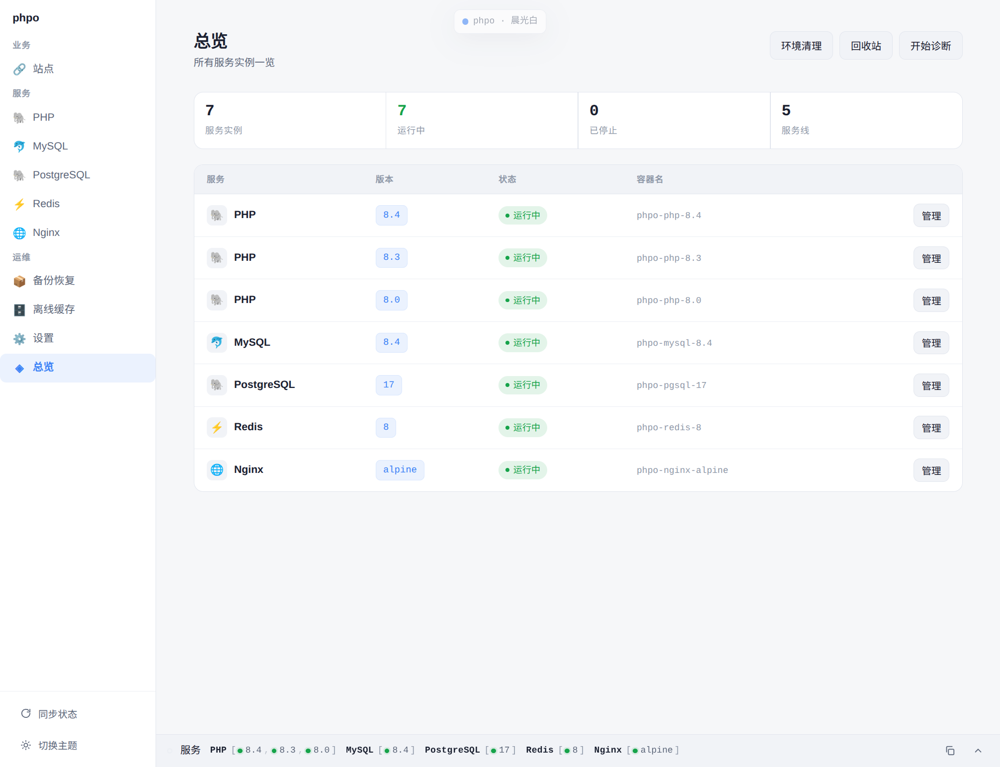

### ② PHP 服务页：三个版本并排，各管各的
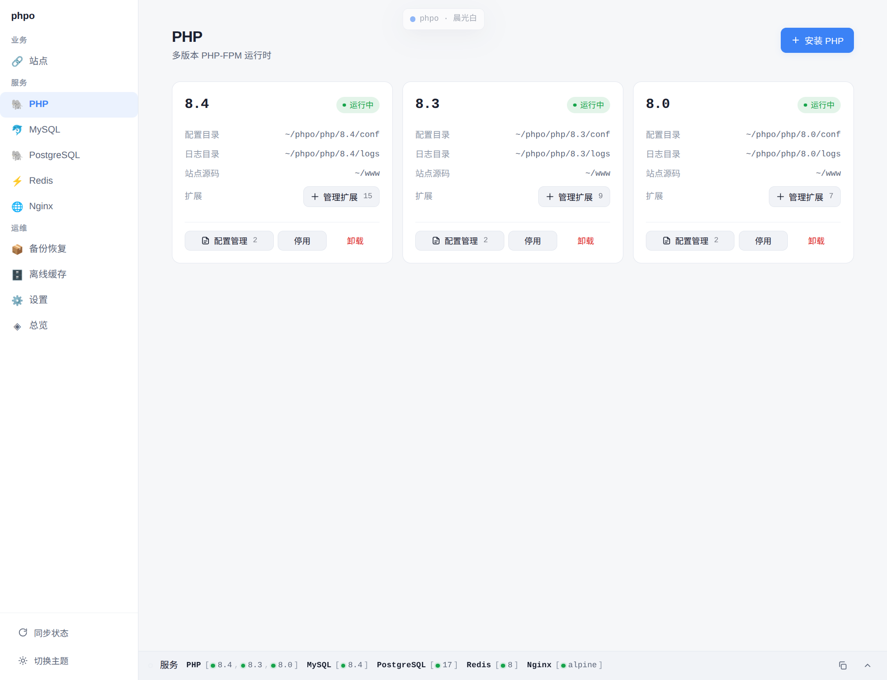

### ③ 站点列表：端口、PHP 版本、健康态，行内就能改
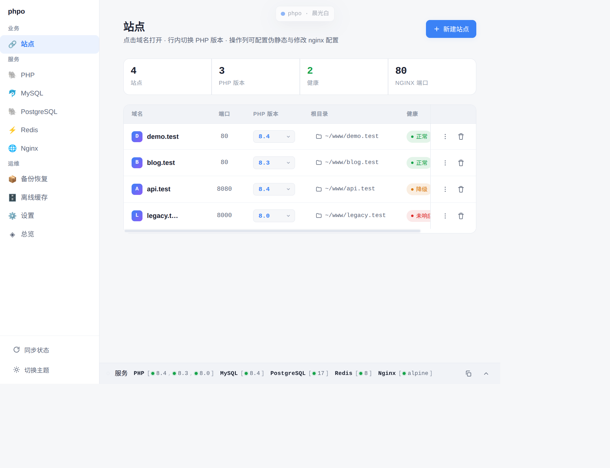

### ④ vhost 正文：nginx 配置直接给你改，落盘前先 `nginx -t`
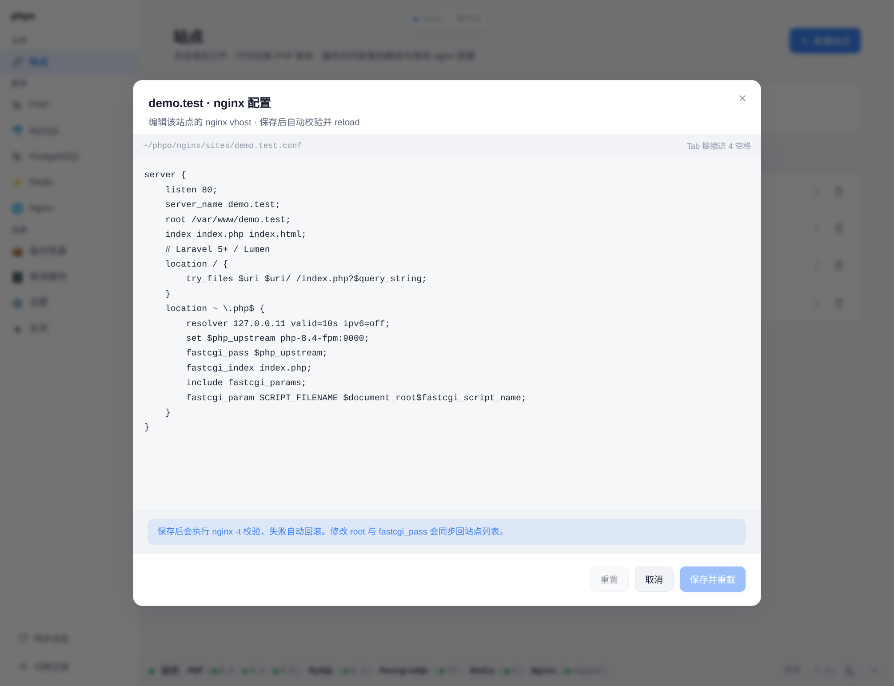

### ⑤ 伪静态：9 种框架预设，中文生态那几个也在
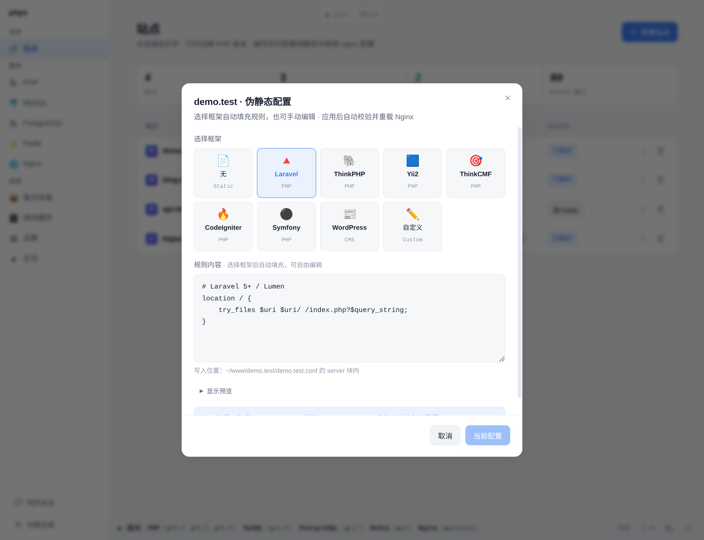

### ⑥ 装 PHP 时就把扩展选好：73 项全量目录，常用 11 项已勾
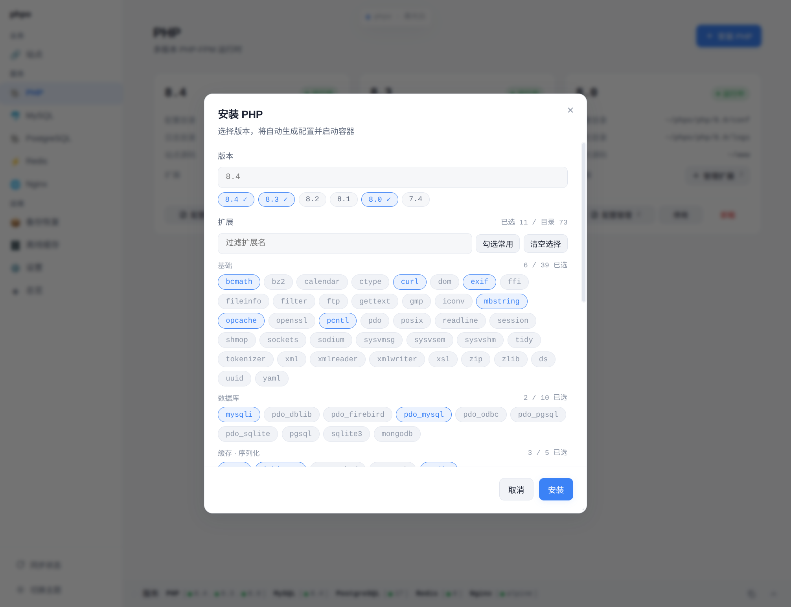

### ⑦ 管理扩展：提交的永远是完整目标集，编译过程逐行直播
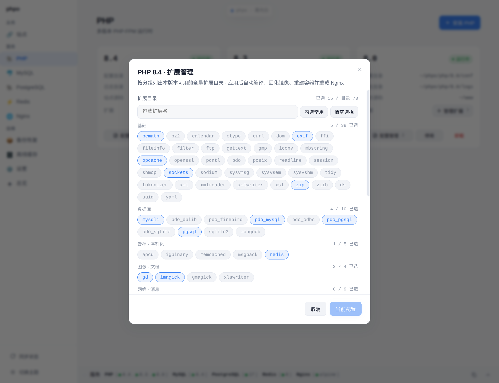

### ⑧ 日志抽屉：每一步在干什么、卡在哪，逐行写给你看
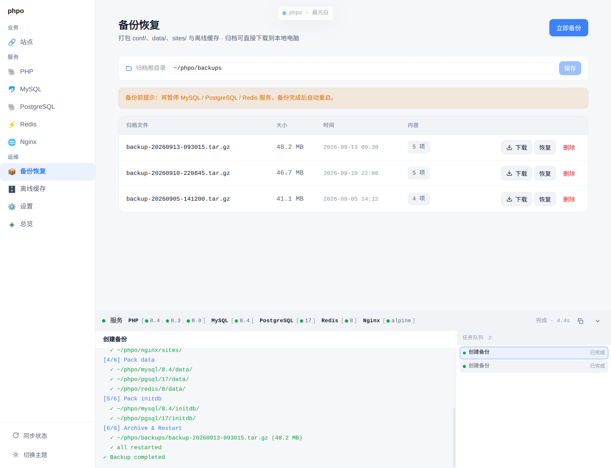

### ⑨ 数据库服务卡：端口、密码、数据目录都摊在脸上
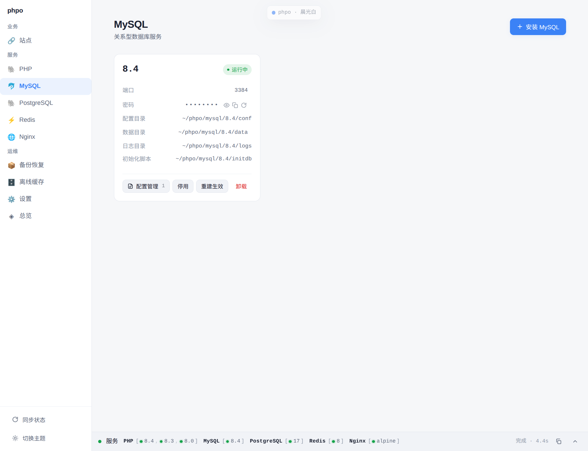

### ⑩ 备份：一键打包，读不动的文件不判死整包
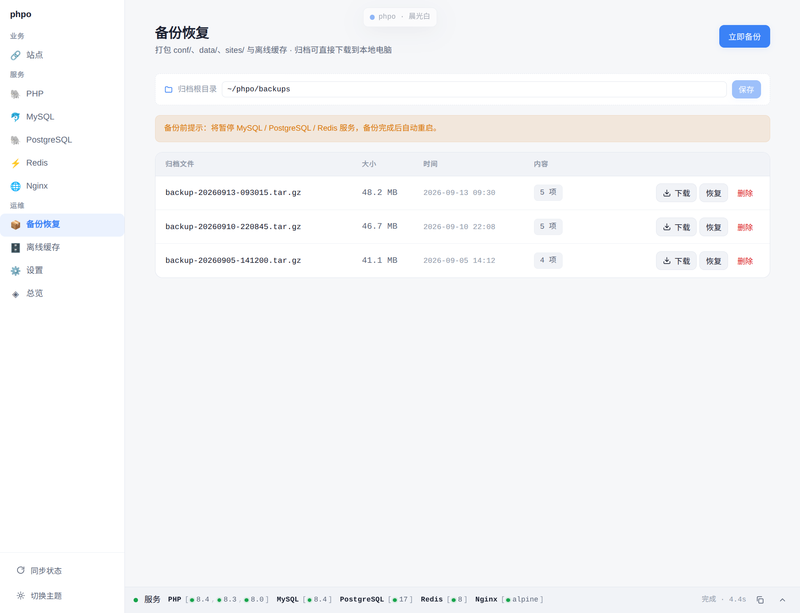

### ⑪ 警告代替阻止：停一个 PHP 之前，说清谁在用它
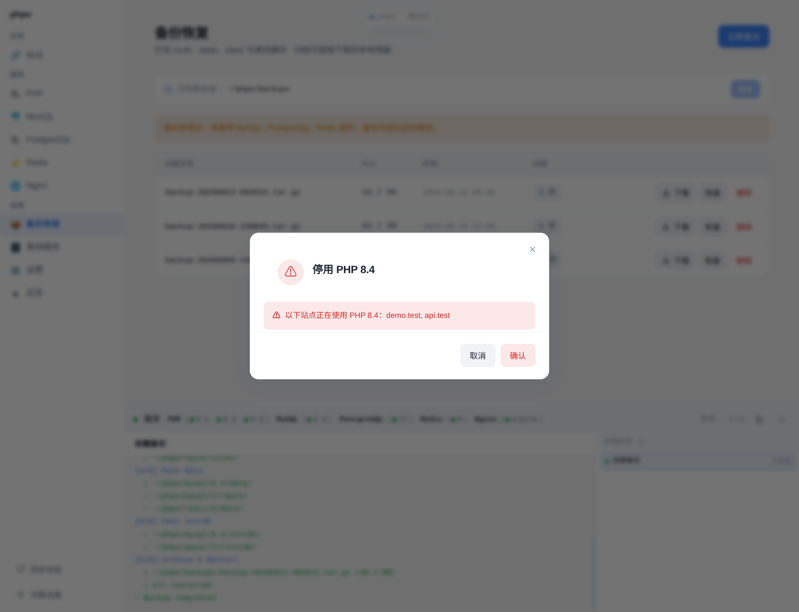

### ⑫ 设置：主题、语言、缩放、托盘
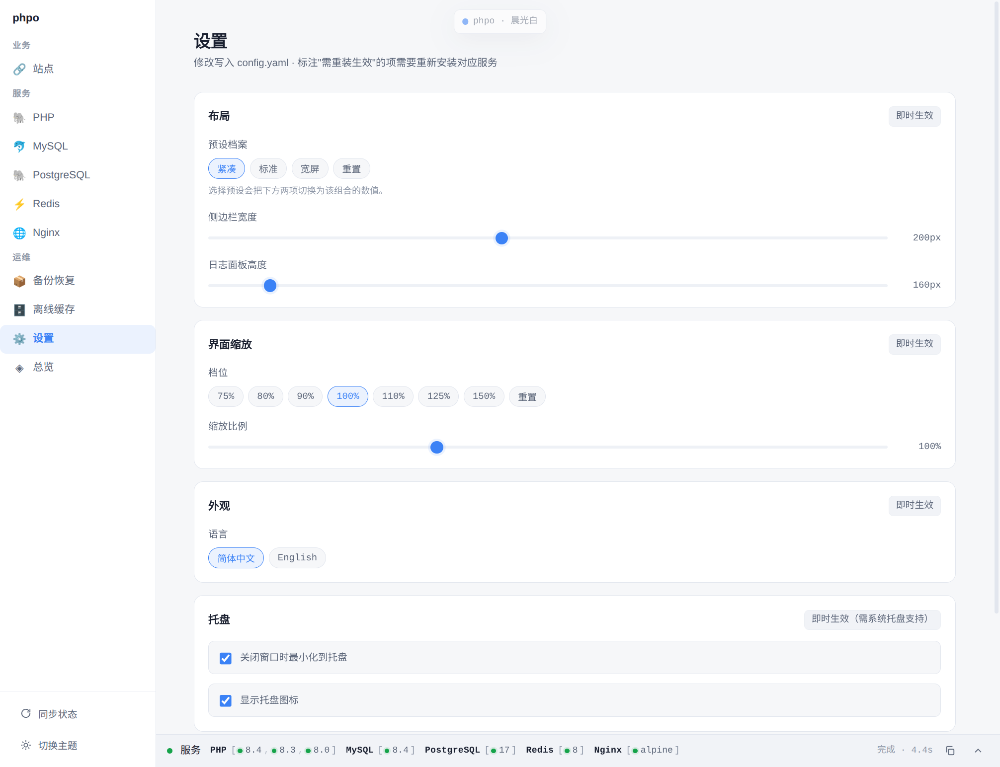

## 安装 / 运行

- Docker 必须在跑；Linux 需 `sudo usermod -aG docker $USER` 后重新登录。
- 首次向导：工作目录根默认 `~/phpo`，站点根默认 `~/www`。
- 十分钟：装 PHP 8.3 → 装 Nginx → 建站 `demo.test` → 开浏览器 → 需要 7.4 再装并下拉切换。
- 数据库默认密码 `123456`，可空；改密码/端口后点“重建生效”。

## 文档

- `docs/` 32 篇中文。
- 改项目先读 `AGENTS.md`。